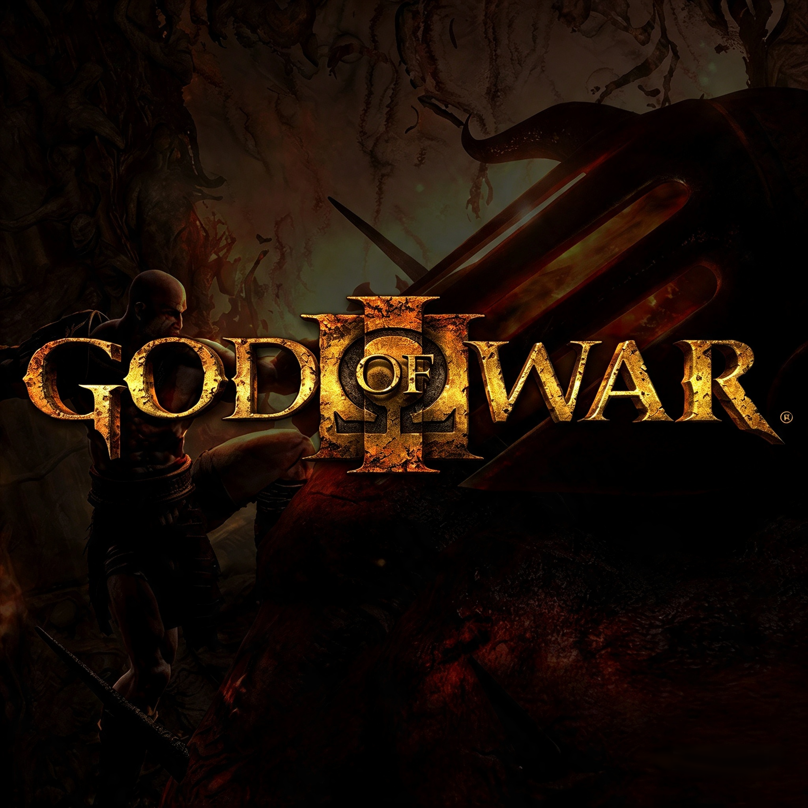

# God of War III — port experimental para Xbox

**GOW3Xsuper é um fork comunitário mantido por [dvine99](https://github.com/dvine99).**
Executa **God of War III Remastered no Xbox Series X|S em Modo de Desenvolvedor**,
a partir de um dump do próprio jogador. **Não é compatível com Xbox One.**

[Baixar versões próprias](https://github.com/dvine99/GOW3Xsuper/releases) ·
[Modificações mantidas](MODIFICATIONS.md) · [Histórico](CHANGELOG.md) ·
[Créditos completos](xbox/CREDITS.md) · [Compilar o port](xbox/README.md)



## Origem: um fork de outro fork

```text
SpartanPort — Felipe Prado e colaboradores
└── gow3_xbox — Devran Cosmo Uenal (Cosmo)
    └── GOW3Xsuper — manutenção e adaptações de dvine99
```

- **[SpartanPort](https://github.com/FelipePrado0/SpartanPort)**, anteriormente
  `gow3_pc`: projeto de Felipe Prado e colaboradores que fornece a base para PC,
  incluindo loader, runtime, integração gráfica, menus e patches.
- **[gow3_xbox](https://github.com/Cosmo/gow3_xbox)**: fork de
  **[Devran Cosmo Uenal](https://github.com/Cosmo)** que adapta essa base ao Xbox.
  Este é o **projeto de origem direto** do nosso repositório. O port para Xbox e
  seu trabalho de integração são creditados a ele e aos colaboradores upstream.
- **[GOW3Xsuper](https://github.com/dvine99/GOW3Xsuper)**: nosso fork desse port,
  com as modificações descritas abaixo. Não reivindicamos autoria das bases herdadas.

Também dependemos de bloodborne_pc, shadPS4, Mesa/Dozen e outros projetos.
A relação de autores, componentes e licenças está em [Créditos](xbox/CREDITS.md).

## O que é este port?

É um aplicativo **UWP experimental para o Developer Mode**. O loader e o runtime
executam o código do dump de PS4; a camada gráfica derivada do shadPS4 traduz os
shaders e comandos para Vulkan, e **Mesa/Dozen traduz Vulkan para Direct3D 12**
no Xbox. Não é uma edição comercial nativa de God of War para Xbox.

**Nenhum arquivo do jogo é distribuído.** Você precisa do seu próprio dump de
God of War III Remastered; o dump de referência do projeto é **CUSA01715**.
Este projeto não tem afiliação ou aprovação da Sony Interactive Entertainment
ou da Santa Monica Studio. God of War pertence aos respectivos titulares.

## O que modificamos e mantemos

| Área | Trabalho deste fork |
| --- | --- |
| Interface | Português brasileiro, espanhol e inglês, com escolha persistente no menu inicial e nas configurações; tradução dos textos controlados pelo aplicativo. |
| Identidade visual | Nome de exibição **God of War III**, logo na inicialização e nova capa com variantes de resolução para os tiles do Xbox. |
| Configurações | 13 controles avançados para caminhos já existentes de gravação, cópias, memória, cache e diagnósticos. |
| Profiling | Correções na coleta de frame pacing, p95/p99, memória e esperas; analisador de logs para comparação. |
| Histórico experimental | Tentativas posteriores de preparação do primeiro início estão documentadas no relatório; as versões .343 e .436 foram retiradas da distribuição. |
| Distribuição | Workflow Windows/UWP com testes, recursos de imagem, empacotamento, assinatura de teste e ZIP no padrão **GOW3xbox<versão>.zip**. |

Consulte o [inventário detalhado](MODIFICATIONS.md), incluindo recursos herdados,
limitações e as alterações retiradas. A tradução da interface do app **não traduz
os diálogos, áudio ou textos fornecidos pelos arquivos do jogo**.

## Releases deste fork

| Versão | Situação | Download |
| --- | --- | --- |
| **Beta 0 — 1.0.26300.308** | Versão publicada atual | [GOW3xbox1.0.26300.308.zip](https://github.com/dvine99/GOW3Xsuper/releases/tag/alpha-1.0.26300.0308) |

As versões **1.0.26300.343 e 1.0.26300.436 foram retiradas**. A Beta 0 corresponde
ao pacote original da .308, sem incorporar essas experiências posteriores. As versões publicadas ficam em
**[Releases do GOW3Xsuper](https://github.com/dvine99/GOW3Xsuper/releases)**.
Veja [como publicamos versões](RELEASES.md) e o [histórico](CHANGELOG.md).

## Instalação no Xbox Series X|S

1. Ative o **Modo de Desenvolvedor** e abra o **Xbox Device Portal** pelo PC.
2. Baixe o ZIP da versão desejada em Releases e extraia no PC.
3. Em **Add**, instale o `.appx` e a dependência da pasta `Dependencies`.
   Se o Dev Home o listar como aplicativo, altere o tipo para **Game**.
4. Copie seu dump — pasta com `eboot.bin`, `sce_module`, `sce_sys` e `dvdroot_ps4` —
   para USB ou para `D:\DevelopmentFiles` no console. A busca automática procura
   `\dumps\GodOfWar3` no USB e até três níveis abaixo de `D:\DevelopmentFiles`;
   use **Escolher pasta do jogo** se necessário.
5. Abra **God of War III**, escolha seu idioma e execute **Preparar** na primeira
   utilização. Na **Beta 0**, use **Pré-compilar shaders** para antecipar a
   preparação, depois **Iniciar jogo**, que carrega o cache de shaders registrado.

Aguarde a preparação terminar. Shaders e estados ainda desconhecidos podem
compilar durante o jogo. **Iniciar jogo sem carregar shaders** é uma alternativa
que pode omitir gráficos enquanto a compilação está pendente;
para testar o primeiro boot, prefira o início normal.

Durante o jogo, **RS + LT** abre o menu. A resolução padrão é 720p. Os controles
avançados indicados como aplicáveis ao próximo início exigem fechar e reabrir o
app. A identidade interna do pacote foi preservada para permitir atualização
sobre a instalação existente e manutenção dos dados.

## Estado atual e problemas conhecidos

- A Beta 0 passou pela compilação Windows/UWP, empacotamento
  e verificação dos arquivos. Isso não substitui testes no console.
- Há relatos de texturas/letras corrompidas no primeiro boot, ghosting e stuttering.
  **A Beta 0 não contém as tentativas de correção da .436, e a correção visual da
  cena relatada não está confirmada no Xbox**.
- Não há ganho de FPS medido deste fork. Preparar shaders pode alongar o
  carregamento, e novas compilações podem causar pausas durante o jogo.
- Memória é limitada no Developer Mode; resoluções altas aumentam a pressão.
  FSR e resolução dinâmica não foram habilitados como recursos funcionais no Xbox.

Para relatar um problema, inclua versão do app, modelo do console, idioma,
resolução, passos para reproduzir, imagem e `loader.log`, sem dados pessoais.
Veja o [guia de diagnóstico e desempenho](xbox/PERFORMANCE.pt-BR.md).

## Licença e reconhecimento

Mantemos a licença [GPL-2.0](LICENSE) e os avisos dos componentes de terceiros.
Os créditos não se limitam aos mantenedores deste fork: leia a
[relação completa de autores e licenças](xbox/CREDITS.md).
